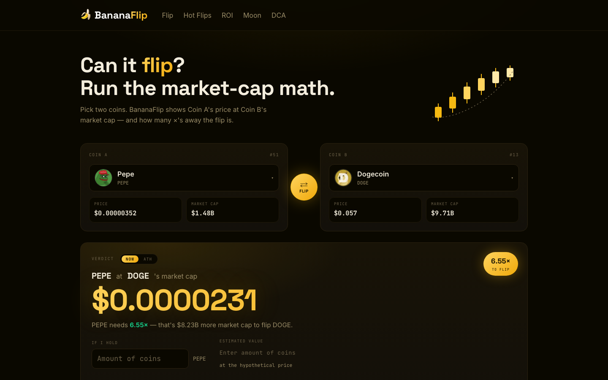
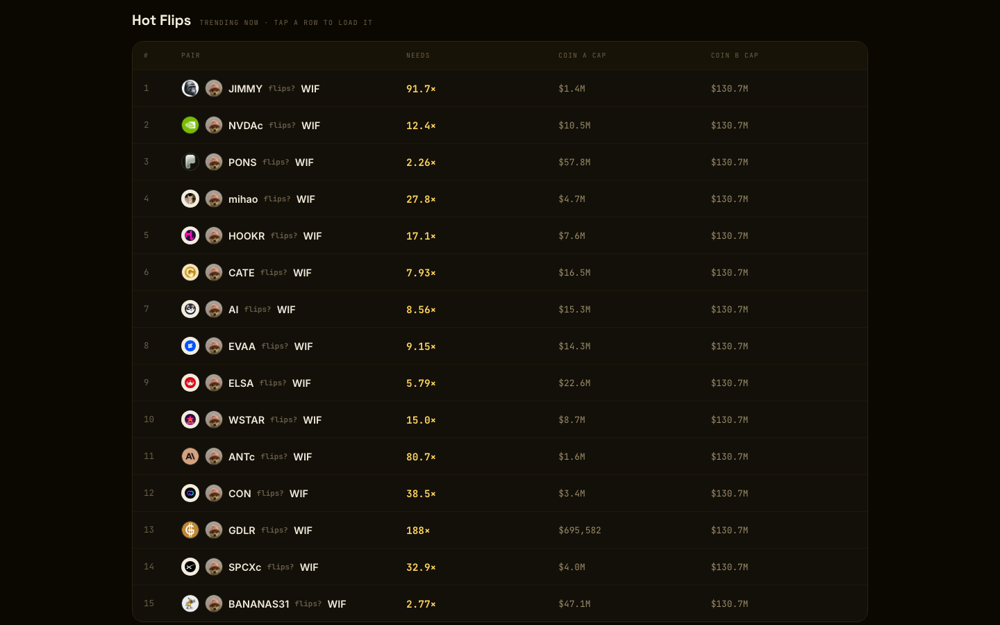
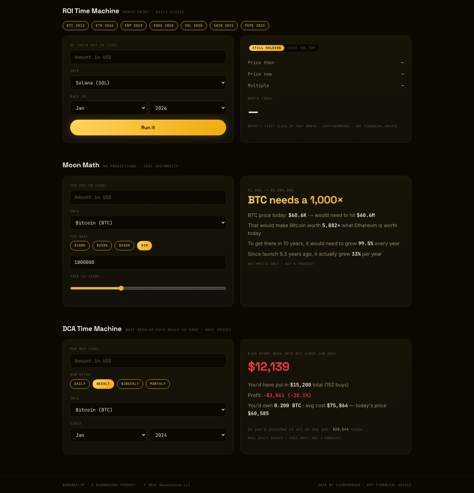

# 🍌 BananaFlip

**Can it flip?** BananaFlip is a crypto market-cap comparison tool. Pick two coins and it shows what Coin A's price would be at Coin B's market cap, and how many times it would have to grow to "flip" it. Three calculators built on real historical prices sit alongside it.

**Live app:** [www.bananaflip.io](https://www.bananaflip.io)



```
impliedPrice = priceA × (mcapB / mcapA)
```

---

## The problem

Crypto communities constantly ask "what would my coin be worth if it reached X's size?" Answering that by hand means looking up two market caps, doing the math, and getting the units right. The answers are also easy to misread: a coin's price alone says nothing about how much it would have to grow. BananaFlip answers these questions instantly with live data, gives every comparison a shareable link, and labels everything as arithmetic, not a forecast.

## Features

- **Market-cap flip comparison.** Choose any two coins from roughly 2,000 ranked coins.
  - BananaFlip shows Coin A's implied price at Coin B's market cap, the multiple needed, and the market-cap gap.
  - A **NOW / ATH** toggle compares against Coin B's all-time-high market cap.
  - An **"If I hold"** input shows what your own amount of Coin A would be worth at that price.
- **Any token by contract address.** Paste an EVM or Solana contract address and BananaFlip looks the token up on DexScreener, stores it, and makes it comparable like any other coin.
- **Hot Flips.** A daily job finds trending memecoins on GeckoTerminal, filters them by liquidity and volume, and pairs each one with the smallest coin on a BONK → WIF → FLOKI → PEPE → SHIB → DOGE → SOL → ETH → BTC ladder that is still bigger than it.
- **ROI Time Machine.** What a past purchase would be worth today, using real daily closing prices. It shows a worst / your entry / best timing range, a "still holding vs. sold the top" toggle, and preset scenarios (BTC 2013 … PEPE 2023).
- **DCA Time Machine.** Replays a fixed USD purchase made daily, weekly, every two weeks or monthly from a chosen start date. It shows:
  - total invested, number of buys, current value, and profit or loss
  - coins owned and average cost
  - the result if the same money had been invested all on day one
  - the same plan applied to BTC
- **Moon Math.** Target arithmetic: how many times a coin must grow to turn an amount into a goal over 1–30 years. It compares the yearly growth that would require with the coin's actual historical growth.
- **Shareable pages.** Every pair has its own URL (`/pepe-flip-doge`) with page metadata and a generated social preview image. Popular pairs are pre-rendered, and there's a sitemap.
- **Demo mode.** Without database credentials the site runs on a bundled data set and is clearly labelled **DEMO DATA**.

| Hot Flips | Calculators (ROI · Moon Math · DCA) |
|---|---|
|  |  |

## How it works

```
 coinpaprika ──(GitHub Actions, every 10 min)──▶ /api/refresh ──▶ Supabase `coins`
 CoinGecko (pinned coins) ───────────────────────┘                      │
                                                                        ▼
 GeckoTerminal trending ─▶ filters ─▶ DexScreener resolver ─▶ Hot Flips set (Vercel Cron, daily)
                                                                        │
 Binance daily closes ─▶ CryptoCompare fallback ─▶ Supabase `coin_history` cache
                                                                        │
                                   Next.js pages + API routes on Vercel ◀┘
```

- **Live prices** for about 2,000 coins come from coinpaprika every 10 minutes and are stored in Supabase.
- **Price history** for the ROI, DCA and Moon Math calculators comes from Binance's public daily price data. CryptoCompare is a fallback, and CoinGecko covers a few pinned coins. History is cached in Supabase so each upstream source is called only about once per coin.
- **Logos** are copied into Supabase Storage and served from the site itself, so the app doesn't depend on third-party image hosts.
- **Every data path has a fallback.** If a refresh fails, the last good data keeps being served. If the trending job finds nothing usable, the previous Hot Flips list stays in place.

## Tech stack

| Area | Technology |
|---|---|
| Web app | Next.js 14 (App Router), React 18, TypeScript |
| Styling | Tailwind CSS with design tokens mirrored as CSS variables; Space Grotesk, Inter and JetBrains Mono via `next/font` |
| Database & storage | Supabase (Postgres + Storage) |
| Market data | coinpaprika, CoinGecko, DexScreener, GeckoTerminal, Binance public data, CryptoCompare |
| Scheduling | GitHub Actions (price refresh), Vercel Cron (trending discovery) |
| Hosting | Vercel |

## Technical challenges and solutions

These are drawn from the commit history and code.

- **Calculators broke in production because of an API quota.**
  - *Problem:* price history originally came only from CryptoCompare, whose free key allows about 100 calls a month. Production used that up, and the ROI and DCA calculators showed "unavailable."
  - *Solution:* make Binance's free public data mirror the main source, keep CryptoCompare only as a fallback, and store history in Supabase so each coin is fetched about once (`app/api/history/route.ts`).
- **Prices quietly stopped updating.**
  - *Problem:* the scheduled refresh called the bare domain, which redirects to `www`. The redirect dropped the authorised POST, so prices went stale without any error.
  - *Solution:* call the canonical `www` host directly (`.github/workflows/refresh.yml`).
- **The DCA calculator got stuck on "unavailable."**
  - *Problem:* temporary network failures were being cached permanently.
  - *Solution:* the client now caches only confirmed "no data" answers and retries after temporary failures (`lib/history-client.ts`).
- **A coin logo vanished on mobile Safari after flipping.**
  - *Problem:* React was reusing the same image element with a changed source.
  - *Solution:* re-mount the image whenever the coin changes, add a retry, and host that logo on the site itself (`components/Disc.tsx`).
- **A data source began blocking hotlinked images.**
  - *Solution:* copy logos into Supabase Storage once and serve them from the app's own `/api/logo/:id` route.
- **Bad historical data.**
  - *Problem:* some sources attach another asset's price history to a ticker.
  - *Solution:* history before any one-day price jump of 1000× or more is ignored.

## How I built this

I built BananaFlip using **AI-assisted development, primarily with Claude Code**. My role was:

- leading the product concept and defining the requirements for each calculator
- approving the visual design, which is kept in `design-reference.html`
- testing on desktop and mobile
- debugging production issues like the ones above
- deploying it on Vercel and Supabase

Claude Code generated most of the code under my direction. The project grew over 56 commits between June and October 2026.

## Disclaimer

Prices come from coinpaprika, CoinGecko and DexScreener. History comes from Binance and CryptoCompare. Demo mode uses seeded example figures and is labelled as such. All calculators are arithmetic on past or current data, not forecasts. **Not financial advice.**

---

# Technical reference

## Development

```bash
cp .env.local.example .env.local   # fill in Supabase credentials
npm install
npm run dev    # http://localhost:3000
npm run build  # production build (also runs lint + type checks)
```

Without credentials the site runs entirely on the bundled demo seed and
shows the **DEMO DATA** pill — handy for offline work.

## Live data pipeline

```
coinpaprika /v1/tickers ──(every 10 min)──▶ POST /api/refresh ──▶ Supabase `coins`
                                                                      │
                getCoins() · 60s cache · demo fallback ◀──────────────┘
                  │
                  ├── pages (ISR, revalidate 60)
                  └── /api/search · /api/coin/:slug · /api/compare
```

1. **Schema** — run [supabase/migrations/0001_create_coins.sql](supabase/migrations/0001_create_coins.sql)
   in the Supabase SQL editor once.
2. **Refresh** — `POST /api/refresh` with `Authorization: Bearer $CRON_SECRET`
   pulls tickers (rank 1–2000, positive market cap), assigns slugs, and
   batch-upserts in chunks of 500. Returns `{updated, skipped, ms}`.
   [.github/workflows/refresh.yml](.github/workflows/refresh.yml) calls it
   every 10 minutes (requires a `CRON_SECRET` repo secret; also supports
   manual `workflow_dispatch`).
3. **Reads** — `getCoins()` in [lib/coins.ts](lib/coins.ts) is the single
   data-access point: Supabase, cached 60 s (busted immediately by the
   refresh via `revalidateTag`). If Supabase is unconfigured, unreachable,
   or empty, it serves [data/coins.json](data/coins.json) and flags
   `isDemoData` — the demo pill comes back and the site never breaks.

### Slugs

URL slugs are the clean lowercase symbol (`btc`, `pepe`). On symbol
collisions the lowest-rank coin keeps the clean slug; later coins get
`symbol-name`. Slugs are assigned on first sight and **never change across
refreshes**, and the 24 original demo slugs are preserved. Slugs never
contain `-flip-` (the pair-URL separator), so `/a-flip-b` parses
unambiguously.

### Colors

The 24 demo coins keep their hand-picked disc colors; every other coin gets
a stable mid-tone color hashed from its symbol ([lib/colors.ts](lib/colors.ts)).

## Environment

| Variable | Purpose |
| --- | --- |
| `SUPABASE_URL` | Supabase project URL (server-side only) |
| `SUPABASE_SERVICE_ROLE_KEY` | Service-role key (server-side only) |
| `CRON_SECRET` | Bearer token guarding `/api/refresh` and `/api/cron/trending` (Vercel Cron sends it automatically) |
| `TRENDING_MIN_LIQUIDITY_USD` / `TRENDING_MIN_VOLUME_USD` | Optional floors for trending tokens (default $100k each) |
| `TRENDING_LIMIT` / `TRENDING_NETWORKS` / `TRENDING_DURATION` / `TRENDING_CONCURRENCY` / `TRENDING_MAX_MCAP_USD` | Optional trending-cron knobs (defaults 15 / `solana,base,eth,bsc` / `24h` / 3 / $20B) |
| `CRYPTOCOMPARE_API_KEY` | Free CoinDesk-data key for ROI price history |
| `COINGECKO_API_KEY` | Optional CoinGecko demo key (headroom for pinned coins) |
| `NEXT_PUBLIC_SITE_URL` | Optional canonical origin for metadata/sitemap |

## Internal API

| Route | Returns |
| --- | --- |
| `GET /api/search?q=do` | Coins matching name/symbol, best rank first (limit 20) |
| `GET /api/coin/:slug` | One coin with its market-cap rank |
| `GET /api/compare?challenger=pepe&target=doge` | Implied price, multiplier, cap gap, already-flipped flag |
| `GET /api/history?symbol=BTC[&year=2017]` | Year range (first→last) or that year's first close, or `{available:false}` |
| `GET/POST /api/refresh` | Cron-only data refresh (bearer auth) |
| `GET /api/resolve?address=0x…` | Any on-chain token by contract (DexScreener), cached in `coins` with a self-hosted logo |
| `GET/POST /api/cron/trending` | Cron-only trending auto-discovery → the Hot Flips set (bearer auth) |

### Pinned CoinGecko coins

Most coins flow through coinpaprika (current values) and Binance (history).
Coins that aren't on Binance — e.g. the Solana Pump.fun token **$ANSEM**
("The Black Bull") — are pinned in [lib/pinned-coins.ts](lib/pinned-coins.ts)
by CoinGecko id + contract (never by ticker; copycats abound) with
`source = "coingecko"`. Their current values (market cap — FDV when
CoinGecko reports one, otherwise circulating cap — plus supply and ATH) are pulled from CoinGecko in the
refresh route and stored in the `coins` table; their history comes from
CoinGecko `market_chart` (capped to the listing date) through the same
`coin_history` read-through cache. Migration 0004 adds the `source` /
`coingecko_id` columns.

### Trending auto-discovery (Hot Flips)

New memecoins reach the site — and fill the **Hot Flips** table — without
anyone pasting contracts. `/api/cron/trending` runs daily at 06:00 UTC on
[Vercel Cron](vercel.json) — the Hobby plan's limit; on Pro, tighten the
schedule to every couple of hours, memecoins move fast — and is guarded by
`CRON_SECRET`, which Vercel sends as `Authorization: Bearer …` on every
scheduled call, so the public can't trigger it.

```
GeckoTerminal trending pools ──▶ quality filters ──▶ DexScreener resolver ──▶ coins (source=dexscreener,
(/networks/trending_pools +         liq ≥ $100k        (same path as a           is_trending + trending_rank)
 solana / base / eth / bsc)         vol24h ≥ $100k      pasted contract:                │
                                    no stables/wrapped  price, marketCap/FDV,     getTrendingCoins() ──▶ Hot Flips, by rank
                                    not in curated list self-hosted logo)
```

1. **Discover** — [lib/trending.ts](lib/trending.ts) pulls GeckoTerminal's
   cross-network trending feed plus one per configured network (ranked by
   real volume/activity, not paid boosts) and merges them into one ranking:
   cross-network order first, then the per-network feeds interleaved so no
   chain crowds out the rest. One candidate per token, carrying its
   strongest pool's liquidity and 24 h volume.
2. **Filter** — liquidity *and* 24 h volume floors (env-configurable),
   stablecoins / wrapped natives / LSTs, and anything already in the curated
   list (top-500 coinpaprika coins + pinned coins: BTC or PEPE are never
   "trending"), plus a sanity cap on market cap.
3. **Resolve** — each survivor goes through the *existing* resolver in
   [lib/token-resolve.ts](lib/token-resolve.ts): DexScreener price and
   `marketCap` (FDV fallback — the same rule as pasted tokens; established
   coins keep circulating cap), the logo self-hosted into the `token-logos`
   bucket (served by `/api/token-logo/:id`), a `coins` row. The feed's own
   image is the fallback logo source. Anything without a price, cap or
   stored logo — or whose DexScreener top pair is under the floors, or on a
   different chain than the feed said — is skipped. At most 3 resolve in
   parallel (storage uploads share the Postgres pool), with upload retries.
4. **Store** — the top 15 are upserted with `is_trending = true` and
   `trending_rank`; the previous run's flags are cleared, so the set
   **reflects what's trending now** and never grows unbounded. Rows are never
   deleted: a coin that drops off the list stays searchable and flippable.
   Migration [0006](supabase/migrations/0006_coin_trending.sql) adds the
   columns.
5. **Show** — `getTrendingCoins()` (own query, 60 s cache, busted by the
   cron) feeds Hot Flips by rank; each trending coin targets the smallest
   rung of the BONK → WIF → FLOKI → PEPE → SHIB → DOGE → SOL → ETH → BTC
   ladder that is still bigger than it ([lib/hot-flips.ts](lib/hot-flips.ts)).
   The main list / picker ranking is untouched — trending is its own flagged
   set. Before the first run, in demo mode, or if the cron can't produce a
   set, the curated `HOT_PAIRS` show instead.

**Graceful failure:** if GeckoTerminal is down, returns nothing, or nothing
passes the filters/resolver, the run reports `kept: true` and leaves the
previous set untouched — Hot Flips never blanks out. Run it by hand with
`node scripts/run-trending-cron.mjs [origin]` (reads `CRON_SECRET` from
`.env.local`).

### NOW / ATH toggle

The verdict panel can compare against Coin B's **all-time-high** market cap
(`ath_price × circulating_supply`; `ath_price` comes from the refresh and
needs [supabase/migrations/0002_add_ath_price.sql](supabase/migrations/0002_add_ath_price.sql)).
The toggle hides for pairs where Coin B has no ATH data.

### ROI time machine

Entry is the first daily close of a selected **month + year**.
`/api/history?symbol=` returns one rich per-coin payload — monthly
first closes, yearly high/low, post-entry tops and the daily series.
Daily closes come from **Binance public klines** (the
`data-api.binance.vision` mirror — free, no key, no monthly cap, not
geo-blocked, full history back to each USDT pair's listing), falling
back to **CryptoCompare** only for coins Binance doesn't list (its free
key is ~100 calls/*month*, so it must stay off the common path).
Payloads are persisted in the Supabase `coin_history` table (migration
0003) and cached in memory, so the upstream is touched ~once per coin
plus a weekly top-up and survives deploys. A stale stored payload keeps
serving whenever an upstream refresh fails. Month/year options adapt to each
coin's first available data. The result shows a WORST TIMING / YOUR
ENTRY / BEST TIMING spread (bought the year's top / your month / the
year's low), a STILL HOLDING vs SOLD THE TOP exit toggle (sell at the
highest close after entry), and preset scenario chips (BTC 2013 …
PEPE 2023). `CRYPTOCOMPARE_API_KEY` (free at developers.coindesk.com) is
only needed for coins Binance doesn't list; when no source has data for a
coin, the calculator shows *historical data unavailable for this range*. Demo mode synthesizes the
same shapes from seeded figures, labeled as such.

### Moon math

Target-mode arithmetic — no predictions: amount, coin, target chips or a
custom target, and a 1–30 year horizon. Shows the required multiple,
required price, implied market cap compared with Bitcoin's live market
cap (Ethereum's when the coin is BTC), and required vs
historical compound pace (the latter from the same cached history fetch
the ROI uses; "since launch" when the coin is younger than the horizon).

### DCA time machine

Replays a fixed USD buy (default $100) on a daily, weekly, biweekly or
monthly schedule from a chosen month and year (2011 onward) against real
daily closes from the same `/api/history` payload. Shows total invested,
number of buys, current value, profit ($ and %), coins owned and average
cost vs. today's price, a lump-sum-on-day-one comparison, and the same
plan into BTC. Starts earlier than a coin's data clamp to "since launch".
Demo mode skips history entirely.

### Coin logos

Pickers and the hot-flips table show coinpaprika logos (mirrored into our
Supabase Storage and served by `/api/logo/:id`), falling back to the
colored monogram disc on load errors and in demo mode. Resolved and
trending tokens carry a self-hosted copy of their DexScreener/GeckoTerminal
image (`/api/token-logo/:id`), so the browser never hotlinks a third-party CDN.

## Shareable flip pages

Every comparison has a canonical URL: **`/<coinA>-flip-<coinB>`**
(the API keeps `challenger`/`target` as its query-param names).
Hot pairs and the top-10 permutations are statically generated; any other
valid pair renders on first request and is cached (ISR, 60 s). Each page
gets its own `<title>`, meta description, canonical and OpenGraph tags.
The sitemap lists the hot pairs plus top-40 × top-8 targets (≤600 URLs),
regenerated hourly.

## Design

[design-reference.html](design-reference.html) is the approved design and the
source of truth. The CSS in `app/globals.css` is a 1:1 port of its stylesheet;
components reproduce its markup, animations (card flip, verdict count-up) and
breakpoint behavior, and respect `prefers-reduced-motion`.
